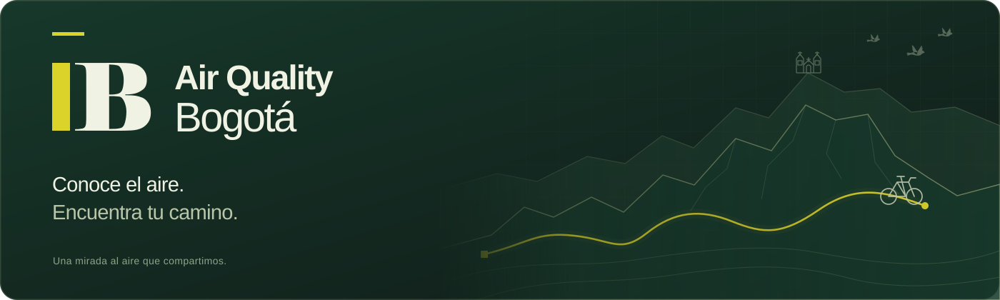
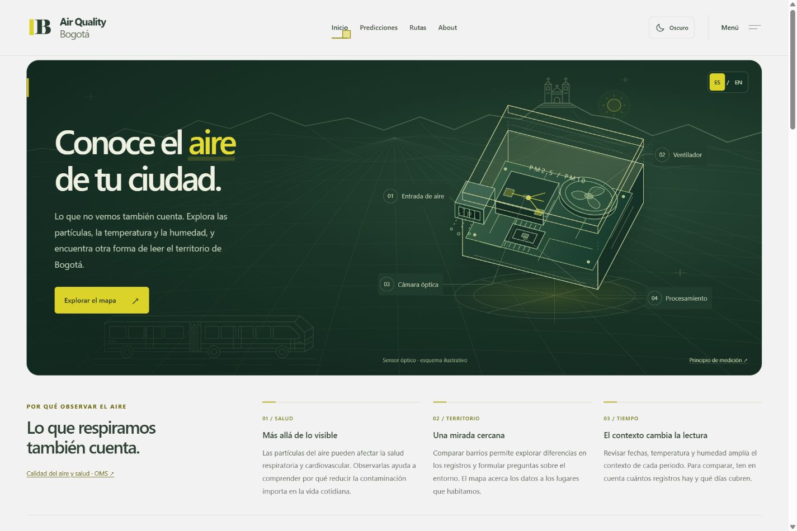
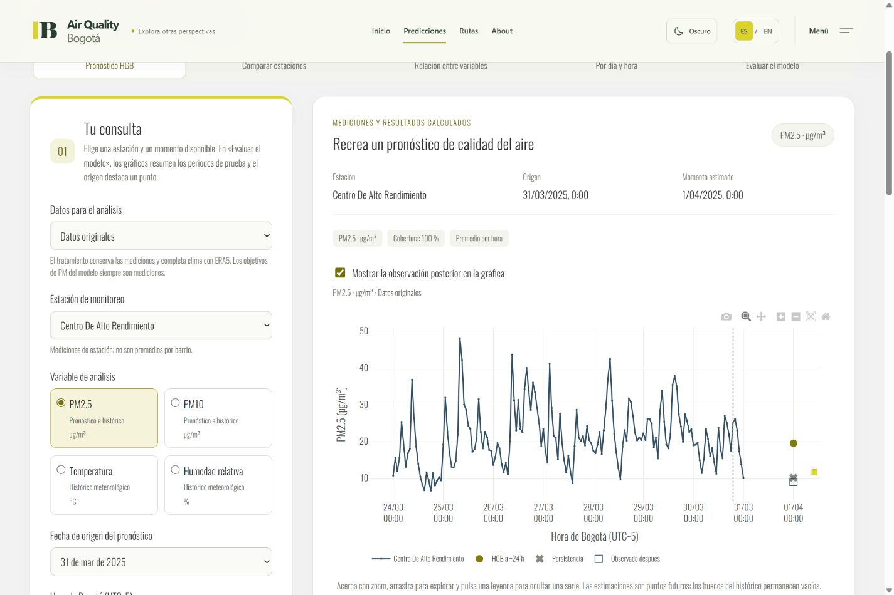
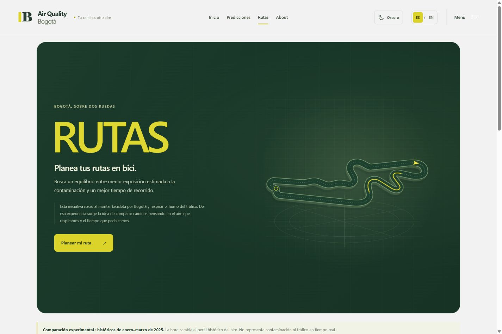
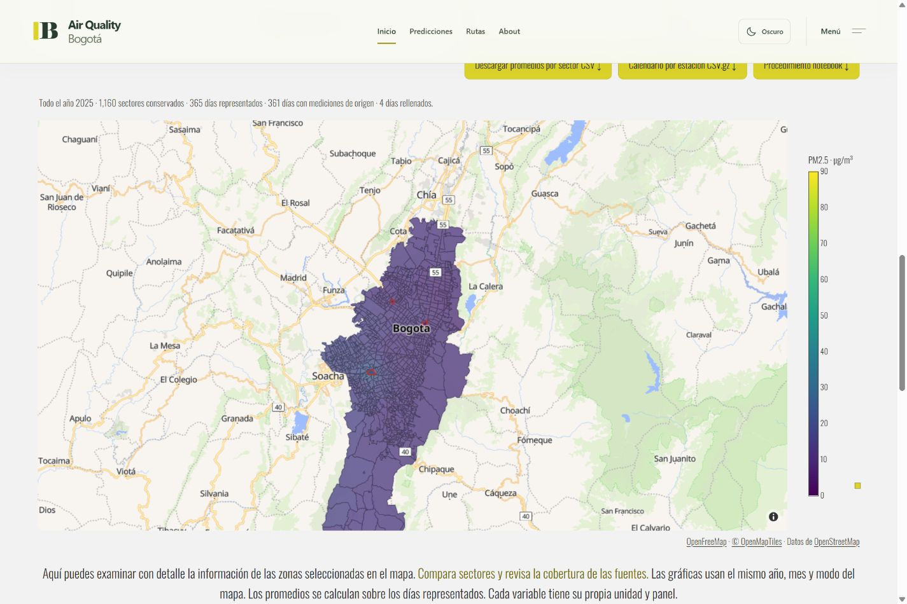

<p align="center">
  
</p>

<p align="center">
  <strong>Datos para conocer el aire que respiramos y pensar cómo recorremos Bogotá.</strong>
</p>

<p align="center">
  <a href="#el-proyecto">El proyecto</a> ·
  <a href="#explora">Explora</a> ·
  <a href="#inicio-local">Inicio local</a> ·
  <a href="#datos-y-alcance">Datos y alcance</a> ·
  <a href="#contribuir">Contribuir</a>
</p>

---

## El proyecto

**Air Quality Bogotá nació montando bicicleta.** Entre el tráfico y el humo apareció una pregunta: ¿podemos entender mejor el aire de la ciudad y tener más información al elegir por dónde pedalear?

El proyecto reúne un explorador ambiental, resultados históricos de modelos de predicción y un comparador experimental de rutas en bicicleta. Una forma de conectar los datos con el territorio y con los recorridos de todos los días.



## Explora

| Sección | Qué puedes hacer |
|:---|:---|
| **Inicio** | Conocer cómo funciona un sensor óptico y explorar PM2.5, PM10, temperatura y humedad en mapas, series y comparaciones. |
| **Predicciones** | Recrear pronósticos históricos de PM2.5 y PM10 a **24, 48 y 72 horas**, comparar estaciones y examinar los errores del modelo. |
| **Rutas** | Elegir origen, destino, día y hora; comparar hasta tres alternativas en bicicleta por **tiempo, exposición estimada y equilibrio entre ambos**. |
| **About** | Conocer el contexto del proyecto, su creador, el trabajo con los datos y las formas de contacto. |

<table>
  <tr>
    <td width="50%">
      
      <p><strong>Del histórico a una estimación.</strong><br />Explora el resultado y el contexto del modelo.</p>
    </td>
    <td width="50%">
      
      <p><strong>Tu camino, otro aire.</strong><br />Compara alternativas para tu próximo recorrido.</p>
    </td>
  </tr>
</table>

La interfaz tiene **español e inglés**, temas **claro y oscuro**, adaptación a móvil y animaciones que respetan la preferencia de movimiento reducido. El verde de los cerros, el amarillo de la marca y los detalles de Bogotá acompañan la exploración.

<details>
  <summary><strong>Ver el explorador ambiental</strong></summary>
  <br />
  
  <p>Mapa por sectores, históricos por estación, filtros temporales y descargas para continuar el análisis.</p>
</details>

## Datos y alcance

Las variables ambientales son **PM2.5 y PM10** en µg/m³, **temperatura** en °C y **humedad relativa** en %.

| Capa del proyecto | Cómo se debe interpretar |
|:---|:---|
| **Observaciones del aire** | Histórico SISAIRE/SDA y muestras RMCAB: **1.323.391 filas de estación/hora y 4.013 fechas entre 2015 y 2025**. Conserva los vacíos de medición y la procedencia de los registros. |
| **Contexto meteorológico** | Reanálisis **Open-Meteo/ERA5** en cuatro celdas de 0,25°. Completa temperatura y humedad ausentes; lluvia y viento aportan contexto al modelo. Es una estimación meteorológica, no una medición por barrio. |
| **Mapa por sectores** | Estimaciones espaciales para **1.160 sectores**. Puedes comparar **Datos originales** y **Datos con tratamiento**; este último incorpora relleno temporal y variación sintética identificada. ERA5 conserva su procedencia y no recibe ruido sintético. |
| **Predicciones HGB** | Resultados históricos precalculados: ajuste final con datos de **2015–2024** y prueba en cuatro semanas de **2025**, a **24, 48 y 72 horas**. Los objetivos de PM son observados; el mapa no participa en el entrenamiento. |
| **Rutas experimentales** | Compara recorridos de BRouter con perfiles históricos de **enero–marzo de 2025**. El indicador combina concentración y tiempo; no es una medición personal ni dosis inhalada. |

> **Cada capa muestra su alcance.** El histórico conserva ausencias horarias y cinco fechas de 2020 sin mediciones utilizables. Las predicciones son una evaluación retrospectiva; la web no genera pronósticos actuales. Las rutas usan perfiles históricos, sin tráfico ni contaminación en tiempo real.

Consulta el [contrato y la procedencia de los datos](data/README.md) y la [metodología de mapas, modelos y rutas](docs/METODOLOGIA.md).

## Inicio local

Necesitas **Python 3.11**, **Node.js compatible con Vite 5** y **npm**. El entorno Python del servidor está validado con 3.11.9. Los comandos siguientes usan **PowerShell en Windows**; la [guía de desarrollo](docs/DESARROLLO.md) incluye Git Bash y más detalles.

### 1. Prepara el proyecto

```powershell
git clone https://github.com/CamiloHedzz/Air_Quality_Bogota.git
cd Air_Quality_Bogota

py -3.11 -m venv .venv
.\.venv\Scripts\python.exe -m pip install -r requirements-local.txt
npm --prefix airquality_front ci
```

### 2. Inicia Django y Dash

Desde la raíz del repositorio:

```powershell
$env:PYTHONUTF8 = "1"
$env:PYTHONDONTWRITEBYTECODE = "1"

.\.venv\Scripts\python.exe -B manage.py migrate --settings=airquality_api.settings_local
.\.venv\Scripts\python.exe -B manage.py runserver 127.0.0.1:8000 --settings=airquality_api.settings_local
```

### 3. Abre otra terminal e inicia React

También desde la raíz del repositorio:

```powershell
npm --prefix airquality_front run dev -- --port 5173 --strictPort
```

Abre **[http://localhost:5173](http://localhost:5173)**. El servidor de datos y Dash se ejecuta en el puerto **8000**; la interfaz, en el **5173**.

La configuración local usa una base SQLite independiente en `.local/db.sqlite3`, sin configurar PostgreSQL. Las muestras y los paquetes históricos están incluidos: **no necesitas ejecutar notebooks ni entrenar modelos para explorar la web**. Los fondos de mapa y los servicios de búsqueda y rutas requieren conexión a Internet.

## Cómo está construido

| Parte | Tecnología |
|:---|:---|
| Interfaz | React 18, Vite y React Router |
| API y servidor | Django, Django REST Framework y SQLite en desarrollo local |
| Mapas y gráficos | Dash, Plotly y MapLibre |
| Datos e investigación | pandas, NumPy, scikit-learn y Jupyter |
| Lugares y recorridos | Photon, BRouter y datos de OpenStreetMap |

```text
Air_Quality_Bogota/
├── airquality_front/       Interfaz, idiomas, temas y animaciones
├── airquality_api/         Configuración y rutas de Django
├── dash2/                  Explorador, gráficos y API de mapas/predicciones
├── rutes/                  Búsqueda y comparación de recorridos
├── data/                   Muestras, manifiestos, mapas e informes
├── research/               Recolección, tratamiento y experimentos
├── notebooks/              Investigación reproducible
└── docs/                   Guías y recursos del README
```

## Documentación

| Guía | Contenido |
|:---|:---|
| [Desarrollo local](docs/DESARROLLO.md) | Entornos, instalación, comprobaciones, API y configuración del servidor. |
| [Datos y procedencia](data/README.md) | Fuentes, unidades, cobertura, calidad y contrato de los archivos. |
| [Metodología](docs/METODOLOGIA.md) | Exposición en rutas, tratamiento del mapa, experimentos HGB y reproducción de resultados. |
| [Histórico integrado · notebook 05](notebooks/05_integracion_historica_2015_2025.ipynb) | Integración 2015–2025, contexto ERA5 y evaluación histórica del modelo vigente. |
| [Notebooks anteriores](notebooks/) | Auditorías y experimentos 01–04 que documentan la evolución del proyecto. |

Para comprobar el frontend:

```powershell
npm --prefix airquality_front run build
```

Las comprobaciones del backend y los experimentos están en la [guía de desarrollo](docs/DESARROLLO.md#comprobaciones).

## Contribuir

**Hagamos algo increíble. Hagamos que esto crezca.**

Puedes aportar mejoras de accesibilidad y visualización, datos con procedencia verificable, pruebas del modelo o ideas para comparar recorridos. En los cambios de datos, conserva la distinción entre observaciones, estimaciones y resultados históricos.

- [Comparte una idea o reporta un problema](https://github.com/CamiloHedzz/Air_Quality_Bogota/issues).
- [Envíame un email](mailto:camilohedzz@gmail.com).
- [Conoce el proyecto en GitHub](https://github.com/CamiloHedzz/Air_Quality_Bogota).

## Fuentes y créditos

Los registros de calidad del aire proceden de **[SISAIRE / IDEAM](https://sisaire.ideam.gov.co/ideam-sisaire-web/consultas.xhtml)** y de **[RMCAB / Secretaría Distrital de Ambiente de Bogotá](https://www.ambientebogota.gov.co/es/red-de-monitoreo-de-calidad-del-aire-de-bogota-rmcab)**. El contexto meteorológico utiliza **[Open-Meteo / ERA5](https://open-meteo.com/en/docs/historical-weather-api)**.

Los mapas y recorridos utilizan **OpenStreetMap**, **OpenFreeMap**, **OpenMapTiles**, **Photon** y **BRouter**, con sus atribuciones correspondientes en la interfaz. El [documento de datos](data/README.md#fuentes) amplía la procedencia y el tratamiento.

Autores del proyecto: **Camilo Hernández y Juan Arias**.

---

<p align="center"><strong>Hecho con amor para mi Bogotá.</strong> 💛</p>
